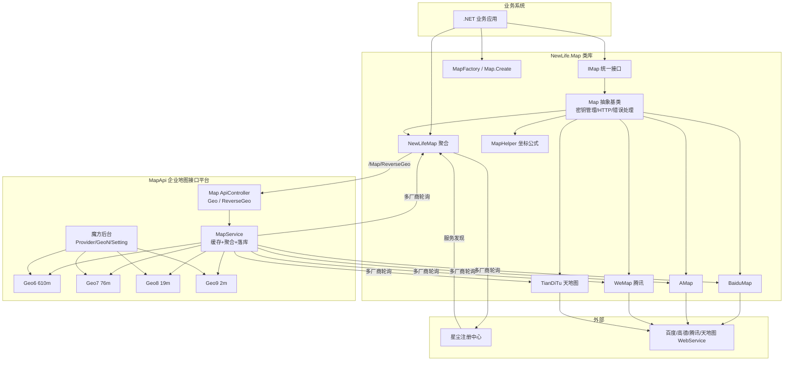
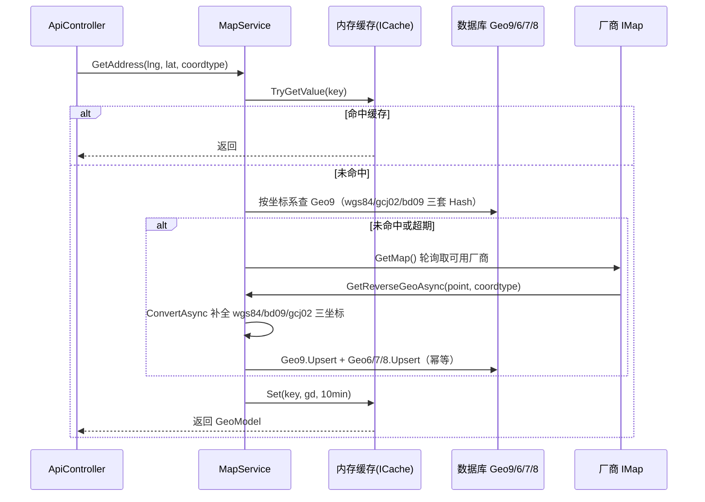
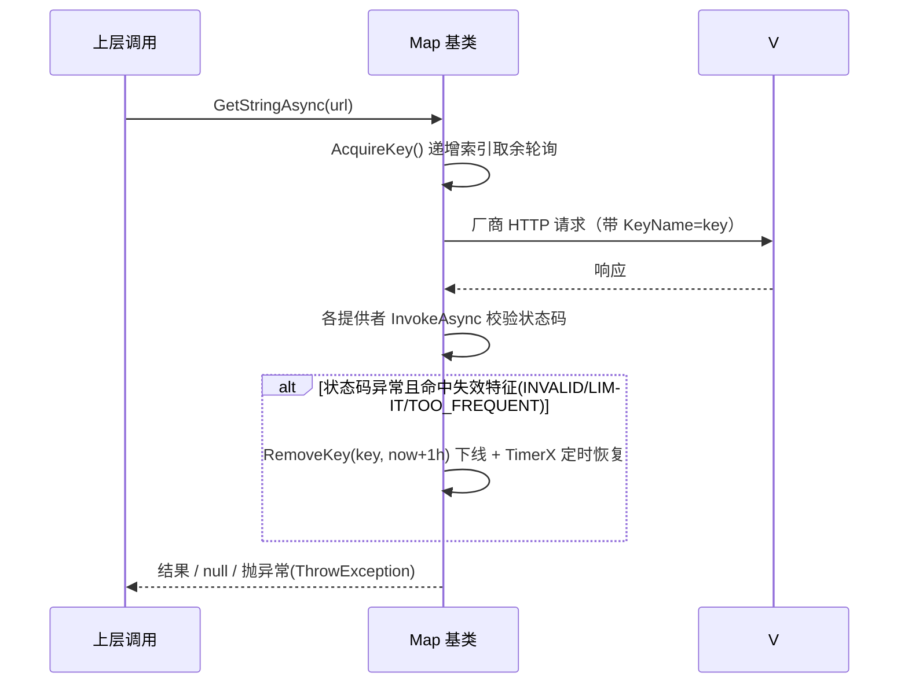

# 架构设计 — NewLife.Map 统一地图组件库与企业地图接口平台

> 本文档由代码结构生成（重建模式），2026-08-04
> 标注「待补充」的流程需人工确认后完善。

## 1. 总体架构

**分层原则**：`NewLife.Map` 为底层基础类库（不依赖 MapApi），`MapApi` 为上层平台（引用类库）。二者通过 `NewLifeMap` 提供者与 `/Map/ReverseGeo` 端点形成闭环。

## 2. 工程与模块组件

### 2.1 NewLife.Map 类库（MAP 模块）

| 组件 | 文件 | 职责 |
|------|------|------|
| `IMap` | `Map.cs` | 统一接口：AppKey、GetGeoAsync、GetReverseGeoAsync、GetDistanceAsync、ConvertAsync、日志 |
| `Map` | `Map.cs` | 抽象基类：HTTP 客户端复用、InvokeAsync 解析、密钥轮询/熔断/恢复、坐标离线转换、`Map.Create` 工厂 |
| `MapFactory` | `MapFactory.cs` | 按 `MapKinds` 注册/创建提供者，静态构造预注册 5 家 |
| `BaiduMap` | `BaiduMap.cs` | 百度适配（KeyName=ak，专属 from/to 索引转换，IP 定位） |
| `AMap` | `AMap.cs` | 高德适配（KeyName=key，status 码校验，地址格式化） |
| `WeMap` | `WeMap.cs` | 腾讯适配（专属失效词 TOO_FREQUENT/LIMIT/NOMATCH/RECYCLED，IP 定位） |
| `TianDiTu` | `TianDiTu.cs` | 天地图适配（KeyName=tk，途经点距离，POI 检索） |
| `NewLifeMap` | `NewLifeMap.cs` | 聚合平台客户端：星尘注册中心服务发现（IRegistry/StarFactory），调用 `/Map/ReverseGeo` |
| `MapHelper` | `MapHelper.cs` | 坐标系离线转换公式（WGS84/GCJ02/BD09 互转）+ Parse/Create/ConvertAsync 扩展 |
| 模型 | `Models/*.cs`、`Data/GeoArea.cs` | GeoAddress/Driving/GeoModel/MapKinds/GeoArea/GeoPoint |

### 2.2 MapApi 平台（API 模块）

| 组件 | 文件 | 职责 |
|------|------|------|
| `Program` | `Program.cs` | 启动装配：星尘（AddStardust/RegisterService）、魔方（AddCube/UseCube）、XCode 初始化、Razor Pages |
| `MapSetting` | `MapSetting.cs` | 平台配置（`Config<MapSetting>`，DbConfigProvider） |
| `MapController`(Config) | `Areas/Location/Controllers/MapController.cs` | 魔方设置管理页（`ConfigController<MapSetting>`） |
| `MapProvider` | `Locations/地图提供者.cs/.Biz.cs` | 上游厂商实体：Kind/Enable/Server/AppKey，InitData 自动初始化 |
| `MapProviderController` | `Areas/Location/Controllers/MapProviderController.cs` | 厂商管理页（`EntityController<MapProvider>`） |
| `Geo6/7/8/9` | `Locations/地理数据N位.cs/.Biz.cs` | 四级 GeoHash 缓存实体：三套坐标系 Hash 索引、FindByHash/Upsert/Fill、单对象缓存 |
| `Geo6-9Controller` | `Areas/Location/Controllers/GeoNController.cs` | 地理数据管理页（`EntityController<GeoN>`，Code 列表搜索） |
| `MapService` | `Services/MapService.cs` | 核心服务：内存缓存 → 数据库查询 → 厂商调用 → 坐标转换 → 四级 Upsert |
| `MapController`(Api) | `Controllers/MapController.cs` | 对外 `[ApiController]`：`GET /Map/Geo`、`GET /Map/ReverseGeo`，返回 `GeoModel` |
| `LocationArea` | `Areas/Location/LocationArea.cs` | 魔方区域注册（地理编码） |

> ⚠️ 注意存在两个 `MapController`：`Areas/Location/Controllers/MapController.cs`（配置管理页）与 `Controllers/MapController.cs`（对外 API），命名重复，重构时建议区分。

## 3. 关键流程

### 3.1 逆地理编码主流程（MapService.GetAddress → 四级缓存）

### 3.2 多 Key 轮询与熔断（Map 基类）

### 3.3 星尘服务发现（NewLifeMap）

1. `NewLifeMap(IServiceProvider)` → `InitAsync` 尝试从 `IRegistry`（星尘）创建 `ApiHttpClient`，自动刷新服务端地址；退化路径从 `StarFactory.ResolveAddressAsync("NewLife.Map")` 单次获取。
2. MapApi 侧 `Program.cs` 以服务名 `NewLife.Map` 注册到星尘，节点变化时客户端自动更新地址列表。

## 4. 关键设计决策

| 决策 | 方案 | 理由 |
|------|------|------|
| 统一接口抽象 | `IMap` + 抽象基类 `Map` | 屏蔽厂商差异；公共逻辑（HTTP/密钥/错误）下沉基类，提供者只覆写 InvokeAsync 与各自 URL 拼装 |
| 坐标系处理 | 离线公式（MapHelper）+ 在线转换（百度） | 离线公式零网络成本覆盖主流互转；百度在线转换支持特殊 from/to 索引 |
| Key 稳定性 | 多 Key 轮询 + 失效熔断 + TimerX 恢复 | 单个 Key 超限/封禁时自动摘除，避免整体不可用 |
| 平台缓存 | 内存缓存(10min) + GeoHash 四级表(6~9 位) | 6 位覆盖广、9 位精度高，按需命中；三套坐标分别建 Hash 索引加速查询 |
| 聚合轮询 | MapService 轮询多厂商（含本地 NewLifeMap 提供者） | 平台自身也可作为厂商之一，支持链式部署 |
| 服务发现 | 星尘 IRegistry / StarFactory | MapApi 多副本/蓝绿发布时客户端无感切换 |
| 后台管理 | 魔方（Cube）EntityController/ConfigController | 零代码获得厂商管理、数据浏览、配置页 |
| 服务地址可覆盖 | 各提供者 URL 统一相对 `Server` 基地址 | 原 AMap/WeMap geocoder 使用绝对地址导致 `Server` 被忽略；统一后支持镜像部署与测试环境注入 |
| 提供者创建 | `Map.Create(名称)` 优先匹配工厂注册表，反射扫描仅兜底 | NativeAOT/裁剪环境不支持程序集类型扫描；注册表路径确定且 AOT 安全 |
| 响应解析 | `JsonParser` 实例解析，兼容对象与数组根 | 静态 `JsonParser.Decode` 不支持数组根，导致 Nominatim search 恒返回 null |
| POI 检索 | 天地图采用官方二代 v2/search：指定 region 走行政区划区域搜索（queryType=12/specify），否则普通搜索（queryType=1/mapBound+level），tag 映射 dataTypes | 原实现误用百度接口与响应格式，天地图 POI 检索恒返回 null；specify 支持行政区名称或 9 位国标码，语义与百度 region 对齐 |
| 失效密钥识别 | 仅按失效关键词（INVALID/LIMIT 等）判定，不再因消息包含密钥参数名而跳过 | 原规则使 "INVALID_USER_KEY" 等真实失效消息无法触发熔断，多 Key 场景坏 Key 持续参与轮询 |

## 5. 数据设计

| 表 | 说明 | 关键字段/索引 |
|----|------|--------------|
| `MapProvider` | 上游地图提供者 | Id/Name/Kind/Enable/Server/AppKey；索引 Kind |
| `Geo6` | 地理数据 6 位（610m） | 三套坐标+Hash；索引 Hash/HashBd09/HashGcj02/Code/ProvinceId,CityId,DistrictId |
| `Geo7` | 地理数据 7 位（76m） | 同上 |
| `Geo8` | 地理数据 8 位（19m） | 同上 |
| `Geo9` | 地理数据 9 位（2m，主查询表） | 同上；`Meta.SingleCache` 按 Hash 缓存 |

> 连接串 `Location`（SQLite：`Data Source=..\Data\Location.db`），可由 `appsettings.json` 切换 MySql 等。

## 6. 构建与兼容性矩阵（CI）

| 工作流 | 矩阵 | 说明 |
|--------|------|------|
| `test.yml` | win-x64 / linux-x64 / linux-arm64 / linux-la64 | 确定性单元测试（默认过滤 `Category=Integration`）；LA64 采用 QEMU 用户态仿真 + 龙芯 .NET SDK，以 xunit 独立控制台运行器（纯 IL）承载 x64 编译产物 |
| `aot.yml` | win-x64 / linux-x64 / linux-arm64 / linux-la64 | IL 告警门禁（除 1 条已记录白名单外 0 告警）+ `AotSmoke` 原生发布运行；LA64 无 NativeAOT 后端，以 JIT 冒烟覆盖运行期场景 |

测试分层：厂商真实调用统一标记 `[Trait("Category", "Integration")]` 并在 csproj 默认过滤（`VSTestTestCaseFilter`），CI 与本地默认仅运行确定性测试；确定性测试通过本地 HTTP 桩（`XUnitTest/StubHttpServer.cs`）覆盖各厂商 URL 构造、鉴权参数与响应解析。

AOT 说明：类库仅提供 net45/net461/netstandard2.0/netstandard2.1 目标，`Map.InvokeAsync` 泛型调用 `JsonHelper.Convert` 存在 1 条 IL2091（旧 TFM 编译不将泛型参数裁剪注解传入异步状态机，属工具链限制，已在 aot.yml 白名单记录）；运行期行为由 `AotSmoke` 17 个场景在原生 AOT 产物上实际执行验证。`Map.Create(名称)` 已改为优先匹配工厂注册表、反射扫描仅作兜底（NativeAOT 不支持程序集类型扫描）。

LA64 稳定性：QEMU 用户态仿真下并发线程会放大运行期竞态（实测 xunit 并行执行时程序集解析内部字典被写坏，报 `FileLoadException: xunit.assert`），故 LA64 测试以 `-parallel none` 串行执行并关闭并发 GC 与分层编译（`DOTNET_gcConcurrent=0`、`DOTNET_TieredCompilation=0`）。LA64 与 AOT 各 job 均为 `continue-on-error`（观察期非阻塞），失败时额外输出 `::warning` 注解避免"假绿"；阻断基线为 `test.yml` 的 build 与 win-x64/linux-x64/linux-arm64 单元测试。

## 7. 待补充

- 平台对外 `Geo` / `ReverseGeo` 端点的鉴权策略（当前 `[AllowAnonymous]`，是否需要服务级鉴权待确认）。
- `MapService` 多厂商切换与故障统计的详细时序（当前无 Metrics 埋点）。
- MapApi 端到端联调流程（Test 控制台 + XUnitTest 的 NewLifeMap 集成用例依赖本平台在线）。
